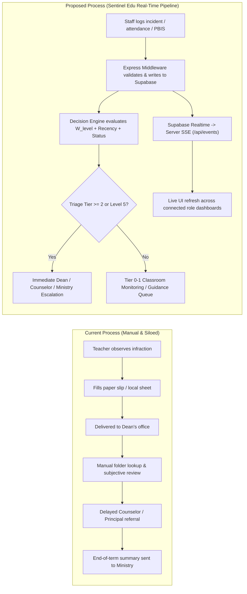
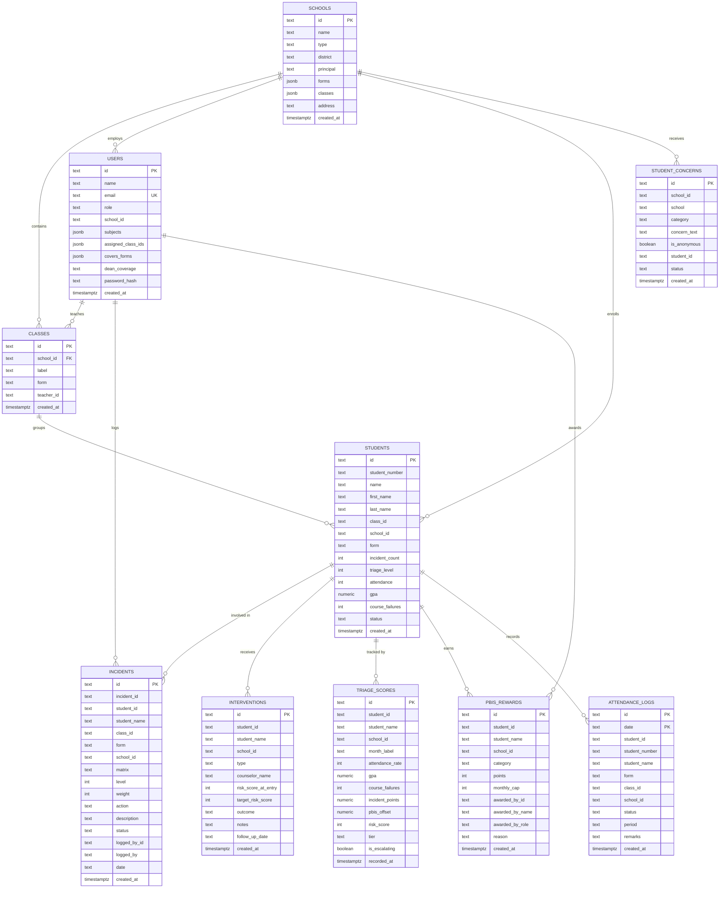
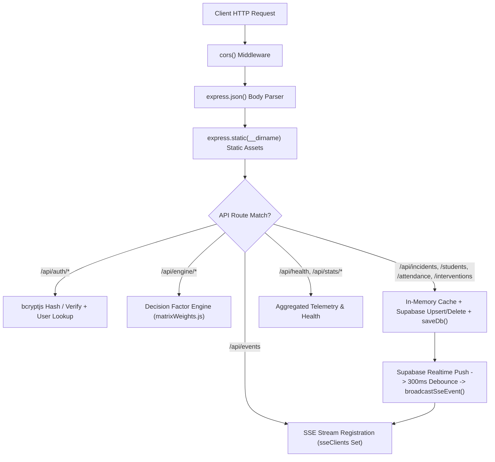
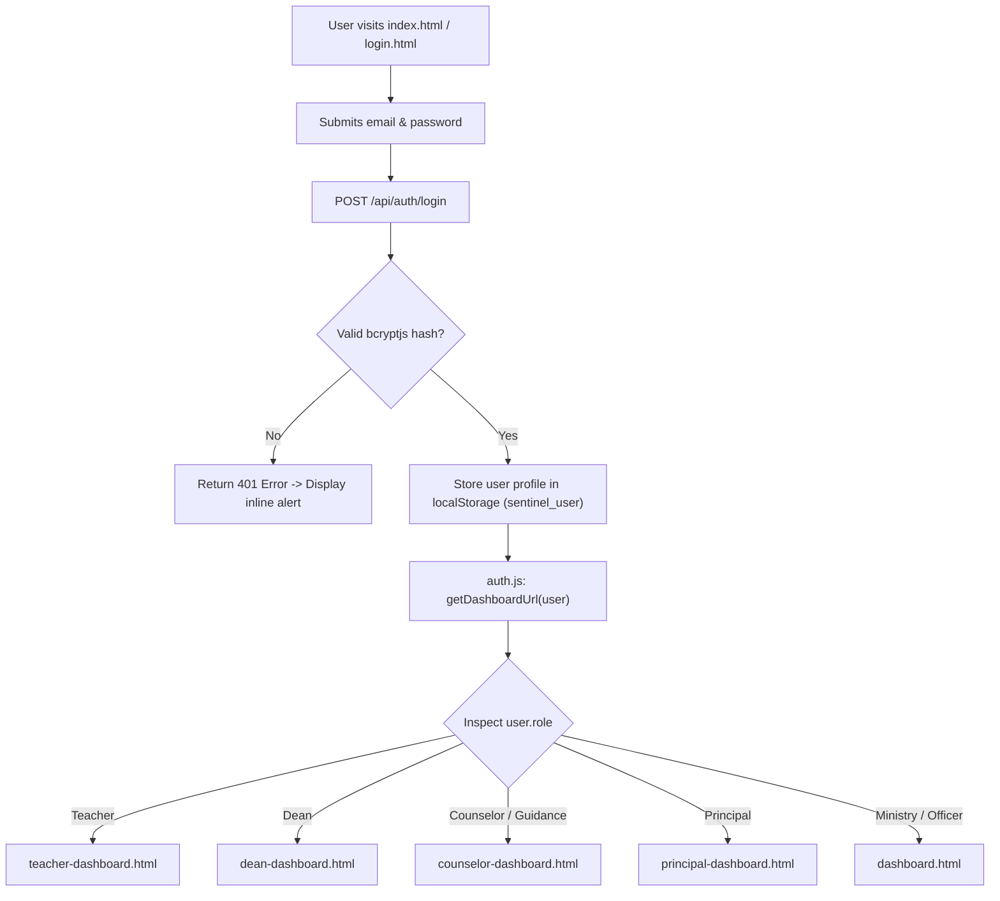

# Sentinel Edu — System Design & Architecture Documentation

This document details the engineering and design work completed across the **Database**, **Middleware & Backend**, and **Frontend** layers of **Sentinel Edu** (National School Triage & Early Warning System), including Entity-Relationship Diagrams (ERDs), UI wireframes, process flow charts, and a comparison of **Current vs. Proposed** operational processes.

---

## 1. Current vs. Proposed Processes

To contextualize the system design, the workflows below contrast the **Current (Legacy/Manual)** school discipline and welfare process against the **Proposed (Sentinel Edu)** automated decision-support process.

### 1.1 Process Comparison Summary

| Dimension | Current Process (Manual / Fragmented) | Proposed Process (Sentinel Edu) |
| :--- | :--- | :--- |
| **Incident Logging** | Paper referral slips, ad-hoc emails, or isolated local spreadsheets per school. | Standardized web form (`incidents.html` / role dashboards) persisted to Supabase PostgreSQL via Express API. |
| **Risk & Triage Scoring** | Subjective, manual review of a student's folder by Deans or Counselors; delayed escalation. | Automated quantitative scoring via `evaluateDecisionFactor()` ([matrixWeights.js](file:///c:/Users/bleas/Documents/finalproject/config/matrixWeights.js)) using severity weights ($W_{\text{level}}$), recency decay, and case status. |
| **Attendance Tracking** | Paper registers tallied at month-end; truancy patterns noticed weeks after onset. | Bulk digital logging (`POST /api/attendance/bulk`) stored in range-partitioned `attendance_logs` tables. |
| **Positive Behavior (PBIS)** | Informal praise or unstandardized merit points prone to point inflation. | Audited `pbis_rewards` ledger with DB-enforced per-award limits (`1–25` pts) and monthly caps (`50` pts). |
| **Cross-Role Visibility** | Siloed between Teachers, Deans, Guidance Counselors, Principals, and the Ministry. | Role-scoped dashboards with real-time **Supabase Realtime → SSE (`/api/events`)** push updates. |

### 1.2 Current vs. Proposed Process Flow Chart



---

## 2. Database Design

The data layer is designed around **Supabase (PostgreSQL)** as the primary cloud relational store ([supabase_schema.sql](file:///c:/Users/bleas/Documents/finalproject/supabase_schema.sql)), paired with a local JSON fallback/cache ([database.json](file:///c:/Users/bleas/Documents/finalproject/data/database.json)) and synchronization/backup scripts ([sync_supabase.js](file:///c:/Users/bleas/Documents/finalproject/scripts/sync_supabase.js), [export_backup.js](file:///c:/Users/bleas/Documents/finalproject/scripts/export_backup.js)).

### 2.1 Entity-Relationship Diagram (ERD)



### 2.2 Key Database Design Decisions

1. **Relational + Semi-Structured (`JSONB`) Hybrid**:
   - Core entities (`schools`, `classes`, `users`, `students`, `incidents`, `interventions`, `triage_scores`, `pbis_rewards`, `student_concerns`, `attendance_logs`) are modeled in normalized tables.
   - Multi-valued attributes such as `schools.forms`, `schools.classes`, `users.subjects`, `users.assigned_class_ids`, and `users.covers_forms` use PostgreSQL `JSONB` columns to avoid excessive join-table overhead for school structure metadata.
2. **Monthly Range Partitioning (`attendance_logs`)**:
   - Because daily attendance generates the highest write volume, `public.attendance_logs` is partitioned using `PARTITION BY RANGE (date)` with a composite primary key `(id, date)`.
   - Dedicated monthly partitions (`attendance_logs_2026_07` through `attendance_logs_2026_12`) plus `attendance_logs_default` keep query scans bounded and simplify archival.
3. **Data Integrity & Anti-Inflation Constraints**:
   - `users.email` enforces a `UNIQUE` constraint.
   - `classes.school_id` references `schools(id) ON DELETE CASCADE`.
   - `pbis_rewards.points` enforces `CHECK (points > 0 AND points <= 25)` alongside a `monthly_cap` default of `50` to prevent point inflation.
4. **Row Level Security (RLS) & Realtime Publication**:
   - RLS is enabled across all 10 tables in [supabase_schema.sql](file:///c:/Users/bleas/Documents/finalproject/supabase_schema.sql) (currently configured with permissive development policies for the `anon` key, ready to be tightened to JWT role claims in production).
   - `supabase_realtime` publication is enabled on 7 operational tables: `students`, `incidents`, `attendance_logs`, `classes`, `interventions`, `pbis_rewards`, and `student_concerns`.
5. **Hybrid Local Persistence & Seeding**:
   - On startup, [server.js](file:///c:/Users/bleas/Documents/finalproject/server.js) loads [database.json](file:///c:/Users/bleas/Documents/finalproject/data/database.json) via `loadDb()`, then hydrates all collections from Supabase via `refreshFromSupabase()`. `saveDb()` writes mutations back to disk (stripping `attendanceLogs` from the JSON snapshot to keep disk I/O fast).

---

## 3. Middleware & Backend Design

The backend is a **Node.js / Express (`^4.19.2`)** server ([server.js](file:///c:/Users/bleas/Documents/finalproject/server.js)) listening on port `5000` that acts as both the static file host and the REST/SSE API gateway.

### 3.1 Middleware Pipeline & Request Flow



### 3.2 Core Middleware & Backend Components

1. **Express Middleware Stack** ([server.js](file:///c:/Users/bleas/Documents/finalproject/server.js#L291-L293)):
   - `cors()`: Enables cross-origin requests across local/hosted origins.
   - `express.json()`: Parses incoming JSON payloads for incident logging, bulk attendance, auth, and engine evaluation.
   - `express.static(path.join(__dirname))`: Serves the multi-page HTML/CSS/JS frontend and PWA assets directly from the same origin as the API.
2. **Authentication & Role-Based Access** ([server.js](file:///c:/Users/bleas/Documents/finalproject/server.js#L410-L550), [auth.js](file:///c:/Users/bleas/Documents/finalproject/auth.js)):
   - `POST /api/auth/signup` & `POST /api/auth/login` hash and verify credentials using `bcryptjs`.
   - Client-side middleware in [auth.js](file:///c:/Users/bleas/Documents/finalproject/auth.js) reads `sentinel_user` from `localStorage`, resolves the user's school and role (`Teacher`, `Dean of Discipline`, `Guidance Counselor`, `Principal`, `Ministry Education Officer`), dynamically builds role-specific navigation (`buildNavLinks()`), and routes users to their designated dashboard (`getDashboardUrl()`).
3. **Decision Factor Engine** ([matrixWeights.js](file:///c:/Users/bleas/Documents/finalproject/config/matrixWeights.js)):
   - Quantifies student behavioral risk using the National School Code of Conduct Severity Weighting Matrix ($W_{\text{level}}$):
     - **Level 1** (Minor): weight `1` | **Level 2** (Minor-to-Moderate): weight `3` | **Level 3** (Moderate-to-Serious): weight `7` | **Level 4** (Serious & Dangerous): weight `12` | **Level 5** (Critical/Criminal): weight `25`.
   - `evaluateDecisionFactor(incidents)` computes each incident's effective score as:
     $$\text{Score}_{\text{incident}} = W_{\text{level}} \times \text{RecencyFactor} \times \text{StatusMultiplier}$$
     - **Recency decay**: $\le 30\text{ days} = 1.0$, $\le 90\text{ days} = 0.85$, $\le 180\text{ days} = 0.70$, $> 180\text{ days} = 0.50$.
     - **Status multiplier**: `Open` $= 1.25$ (escalation premium), `Resolved` $= 0.80$.
   - Maps cumulative score to **Triage Tiers**:
     - **Tier 0** (`0–4`): Low Risk (Classroom Monitoring)
     - **Tier 1** (`5–14`): Moderate Risk (Guidance Referral)
     - **Tier 2** (`15–29`): Elevated Risk (Dean Formal Intervention)
     - **Tier 3** (`30+`, or **automatic override if any Level 5 incident exists**): High Risk / Crisis (Ministry Escalation)
   - Exposed via `GET /api/engine/matrix-config`, `POST /api/engine/evaluate`, and `GET /api/engine/students-evaluation`.
4. **Real-Time Event Bridge (Supabase Realtime → SSE)**:
   - On boot, [server.js](file:///c:/Users/bleas/Documents/finalproject/server.js#L265-L278) opens Supabase Realtime channels for 7 tables.
   - Incoming `postgres_changes` events trigger `scheduleRealtimePull()` (300ms debounce), which refreshes the in-memory cache from Supabase and pushes an SSE notification to all connected browsers on `GET /api/events` (with a 25-second keepalive heartbeat).

---

## 4. Frontend Design

The frontend is a **multi-page Progressive Web App (PWA)** built with semantic HTML5, vanilla JavaScript, Chart.js, and a unified CSS design system ([style.css](file:///c:/Users/bleas/Documents/finalproject/style/style.css)).

### 4.1 Visual System & PWA Architecture

- **Design Tokens** ([style.css](file:///c:/Users/bleas/Documents/finalproject/style/style.css#L3-L16)):
  - Typography: `Google Sans` & `Product Sans`.
  - Dual-surface palette: Dark editorial landing/header (`--bg-dark: #0f1013`, `--bg-card: #15161b`, `--accent-lilac: #9f96ee`) paired with high-contrast light operational dashboards (`#ffffff`, `#f7f7f9`, `--text-dark: #121316`).
- **PWA & Offline Support** ([manifest.json](file:///c:/Users/bleas/Documents/finalproject/manifest.json), [sw.js](file:///c:/Users/bleas/Documents/finalproject/sw.js)):
  - Service Worker (`sentinel-edu-v4`) pre-caches core HTML/CSS/JS shell assets.
  - Uses a **network-first with cache fallback** strategy for same-origin `GET` requests while explicitly excluding `/api/` routes so live data is never spoofed from cache.

### 4.2 Role-Based Screen Architecture

| Role | Primary Dashboard | Linked Operational Views |
| :--- | :--- | :--- |
| **Public / Unauthenticated** | [index.html](file:///c:/Users/bleas/Documents/finalproject/index.html) | [login.html](file:///c:/Users/bleas/Documents/finalproject/login.html), [signup.html](file:///c:/Users/bleas/Documents/finalproject/signup.html), [reset-password.html](file:///c:/Users/bleas/Documents/finalproject/reset-password.html) |
| **Teacher** | [teacher-dashboard.html](file:///c:/Users/bleas/Documents/finalproject/teacher-dashboard.html) | [classes.html](file:///c:/Users/bleas/Documents/finalproject/classes.html), [participation-points.html](file:///c:/Users/bleas/Documents/finalproject/participation-points.html), [leaderboard.html](file:///c:/Users/bleas/Documents/finalproject/leaderboard.html) |
| **Dean of Discipline** | [dean-dashboard.html](file:///c:/Users/bleas/Documents/finalproject/dean-dashboard.html) | [engine.html](file:///c:/Users/bleas/Documents/finalproject/engine.html), [leaderboard.html](file:///c:/Users/bleas/Documents/finalproject/leaderboard.html), [triage.html](file:///c:/Users/bleas/Documents/finalproject/triage.html) |
| **Guidance Counselor** | [counselor-dashboard.html](file:///c:/Users/bleas/Documents/finalproject/counselor-dashboard.html) | [engine.html](file:///c:/Users/bleas/Documents/finalproject/engine.html), [leaderboard.html](file:///c:/Users/bleas/Documents/finalproject/leaderboard.html), [student.html](file:///c:/Users/bleas/Documents/finalproject/student.html) |
| **Principal** | [principal-dashboard.html](file:///c:/Users/bleas/Documents/finalproject/principal-dashboard.html) | [teachers.html](file:///c:/Users/bleas/Documents/finalproject/teachers.html), [students.html](file:///c:/Users/bleas/Documents/finalproject/students.html), [incidents.html](file:///c:/Users/bleas/Documents/finalproject/incidents.html), [engine.html](file:///c:/Users/bleas/Documents/finalproject/engine.html) |
| **Ministry Officer** | [dashboard.html](file:///c:/Users/bleas/Documents/finalproject/dashboard.html) / [ministry.html](file:///c:/Users/bleas/Documents/finalproject/ministry.html) | [schools.html](file:///c:/Users/bleas/Documents/finalproject/schools.html), [analytics.html](file:///c:/Users/bleas/Documents/finalproject/analytics.html), [overview.html](file:///c:/Users/bleas/Documents/finalproject/overview.html), [engine.html](file:///c:/Users/bleas/Documents/finalproject/engine.html) |

### 4.3 UI Wireframes

#### Wireframe A: Public Landing & Staff Entry ([index.html](file:///c:/Users/bleas/Documents/finalproject/index.html) / [login.html](file:///c:/Users/bleas/Documents/finalproject/login.html))

```text
+-------------------------------------------------------------------------+
| Sentinel Edu.          Programs   Contact     [Staff Login] [Req Access]|
+-------------------------------------------------------------------------+
|                                                                         |
|  SENTINEL Edu: NATIONAL EDUCATION DECISION SUPPORT SYSTEM               |
|                                                                         |
|  Centralized behavioral analytics,      +-----------------------------+ |
|  multi-level student triage scoring,    | Subscribe to Mailing List   | |
|  and real-time incident tracking...     | [ Email Address *         ] | |
|                                         | [x] Consent checkbox        | |
|  [ Staff Login -> ]                     | [ Subscribe ]               | |
|                                         +-----------------------------+ |
+-------------------------------------------------------------------------+
```

#### Wireframe B: Decision Factor Engine ([engine.html](file:///c:/Users/bleas/Documents/finalproject/engine.html))

```text
+-------------------------------------------------------------------------+
| Sentinel Edu.   Dashboard  Students  Schools  Incidents  Engine   [User]|
+-------------------------------------------------------------------------+
| DECISION ENGINE                                                         |
| Decision Factor Engine & Severity Weighting Matrix (W_level)            |
+-------------------------------------------------------------------------+
| +---------------------------------------------------------------------+ |
| |  Risk Score Trend / Student Evaluation Chart (Chart.js)             | |
| |                                        +--------------------------+ | |
| |     /\      /\                         | Floating Student Card    | | |
| |    /  \____/  \___                     | Hover to highlight       | | |
| |                                        | Score | Tier | Incidents | | |
| |                                        +--------------------------+ | |
| +---------------------------------------------------------------------+ |
|                                                                         |
| +--------------------+  +--------------------+  +---------------------+ |
| | Level 1-5 Matrix   |  | Live Evaluator     |  | Triage Thresholds   | |
| | W_level Breakdown  |  | Select Student ->  |  | Tier 0..3 Protocols | |
| +--------------------+  +--------------------+  +---------------------+ |
+-------------------------------------------------------------------------+
```

#### Wireframe C: Role-Based Operational Dashboard (e.g., [dean-dashboard.html](file:///c:/Users/bleas/Documents/finalproject/dean-dashboard.html) / [teacher-dashboard.html](file:///c:/Users/bleas/Documents/finalproject/teacher-dashboard.html))

```text
+-------------------------------------------------------------------------+
| Sentinel Edu.   My Dashboard  Incidents  Attendance  Students  [User v] |
+-------------------------------------------------------------------------+
| [ KPI: Total Students ] [ KPI: Open Incidents ] [ KPI: Tier 2/3 Alerts ]|
+-------------------------------------------------------------------------+
| +-----------------------------------+ +-------------------------------+ |
| | Action Queue / Recent Incidents   | | Quick Actions                 | |
| | - Student | Level | Status | Act  | | [+ Log Incident]              | |
| | - Student | Level | Status | Act  | | [+ Mark Attendance]           | |
| | - Student | Level | Status | Act  | | [+ Award PBIS Points]         | |
| +-----------------------------------+ +-------------------------------+ |
+-------------------------------------------------------------------------+
```

### 4.4 Authentication & Role Routing Flow Chart


